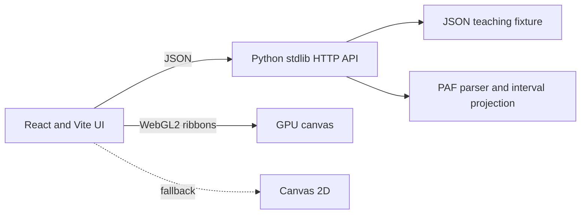

# Architecture

The browser dashboard is mounted with React and bundled by Vite. In development, Vite proxies API traffic to `server.py`; after a production build, the Python server serves the generated `dist/` frontend and the same API. `cgo/bio.py` owns validation and coordinate mapping. The WebGL2 canvas draws the ribbon field, with DOM labels, controls, and evidence tables. WebGL2 falls back to Canvas 2D. The current data fixture is checked into `data/demo.json` and intentionally contains synthetic organisms, coordinates, and alignments. Existing interaction handlers remain in `web/app.js` as the first-stage migration from the original static page.

This architecture is not yet a production service: there is no database, object store, queue, authentication, or persistent upload store. The server binds to loopback by default and is intended for local use.
